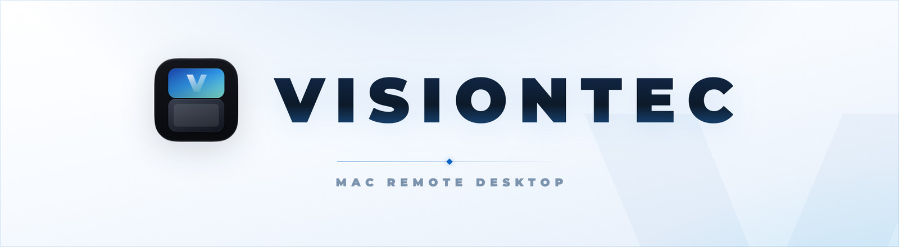
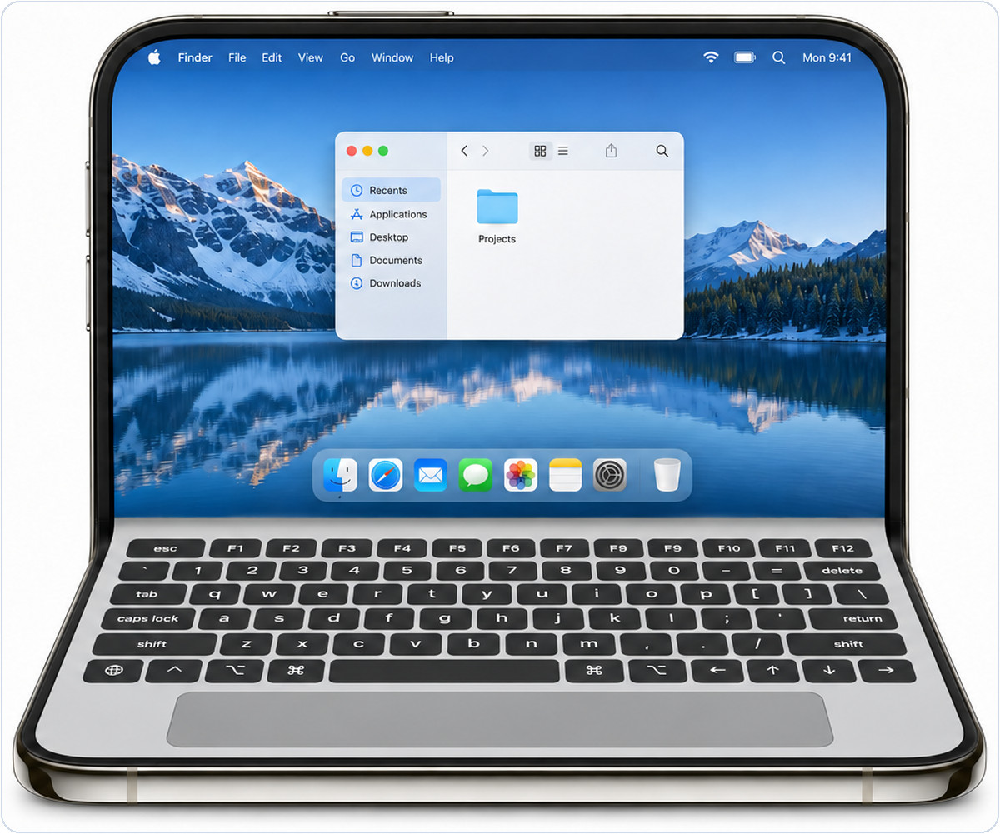
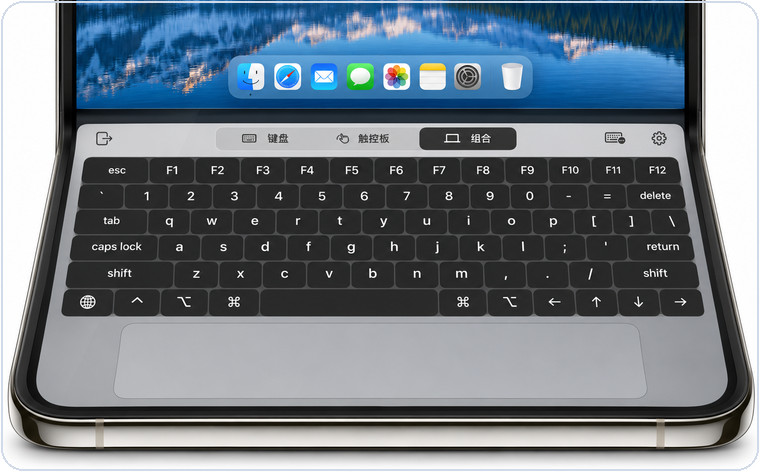
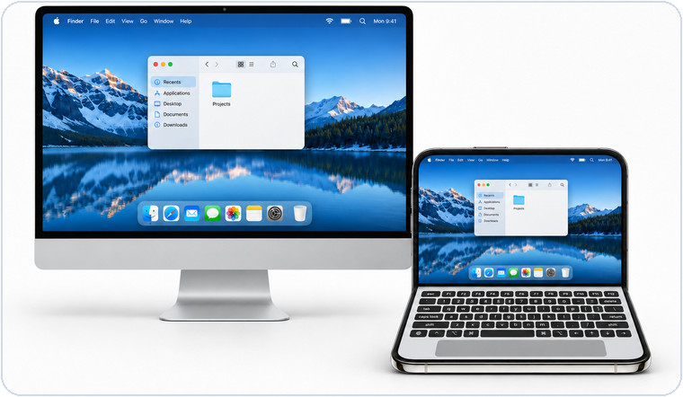

<div align="center">

<picture>
  <source media="(prefers-color-scheme: dark)" srcset="docs/images/readme/hero-dark.jpg">
  <source media="(prefers-color-scheme: light)" srcset="docs/images/readme/hero-light.jpg">
  
</picture>

# DUO你电脑

**把 iPhone Duo 折成一台远程 Mac 笔记本**<br><sub>iPhone Duo 原生远程 Mac 桌面 · 键盘 / 触控板 / 桌面共享</sub>

<br>

<a href="https://space.bilibili.com/18564290">
  
</a>

<br>

<a href="docs/INSTALL.md"></a>
<a href="docs/INSTALL.md"></a>
<a href="docs/DEVELOPMENT.md"></a>
<a href="LICENSE"></a>

</div>

---

<div align="center">

### 一台 Mac，折进你的掌心

</div>

上半屏是完整的 Mac 桌面，下半屏是键盘与触控板。Duo 半折叠时像一台笔记本，展平后又是一块完整的屏幕；**纯键盘**、**纯触控板**、**键盘＋触控板**三种模式随时切换，界面跟随手机的深色模式。

<p align="center">
  <br>
  <sub><i>AI 生成的界面示意</i></sub>
</p>

<div align="center">

### 三种输入，一套手感

</div>

<table>
<tr>
<td width="50%" align="center">
<br>
<b>组合模式</b><br>
<sub>ANSI 全键盘加 Mac 尺寸触控板，修饰键保留状态灯</sub>
</td>
<td width="50%" align="center">
<br>
<b>桌面共享</b><br>
<sub>在 Duo 上选择显示器，完整桌面显示在上屏</sub>
</td>
</tr>
</table>

<p align="center"><sub><i>AI 生成的界面示意</i></sub></p>

## 下载与安装

> [!NOTE]
> [Releases](https://github.com/xav1erwang/DuoDesk/releases) 中的安装包目前仍为草稿，尚未正式发布。现在可以先按下方步骤从源码构建和安装。

| 平台 | 下载文件 | 安装方式 |
| :--- | :--- | :--- |
| **macOS 27+** | `DUO-macOS-universal.dmg` 或 `.zip` | 将应用放入「应用程序」，首次启动按系统提示手动放行 |
| **iOS / iPadOS 27.1+** | `DUO-iOS-unsigned.ipa` | 使用 Sideloadly 或 AltStore Classic，用自己的 Apple 账号重签安装 |

主要适配 iPhone Duo，两端需支持硬件 HEVC。Mac 包包含 Apple Silicon 与 Intel 版本。免费 Apple 账号通常每 7 天需要续签一次。

[详细安装步骤](docs/INSTALL.md) · [自动续签](Signing/README.md)

<details>
<summary><b>从源码构建</b></summary>

<br>

需要完整 Xcode 27.1 或更新版本。

```sh
git clone https://github.com/xav1erwang/DuoDesk.git
cd DuoDesk
bash Scripts/build-duodesk-mac.sh
```

Mac 应用生成在 `Build/DUO你电脑.app`，将它移入「应用程序」并打开。

在 Xcode 中打开 `iOSClient/Sill.xcodeproj`，选择 `Sill` Scheme，在「Signing & Capabilities」中选择自己的 Team 并设置唯一的 Bundle Identifier。用 USB 连接并信任 Duo，按提示开启开发者模式，选择该设备后运行，即可安装手机端。

</details>

## 运行与配对

1. 在 Mac 上打开「DUO你电脑」，按提示允许屏幕录制、辅助功能和本地网络访问，并保持应用运行。
2. 将 Duo 和 Mac 接入同一局域网，在 Duo 上打开「DUO你电脑」，允许本地网络访问，然后在列表中选择你的 Mac。
3. 首次配对时，在 Duo 上扫描 Mac 显示的二维码；也可以选择「输入配对码」，输入 Mac 上显示的数字并点击「配对」。扫码时按提示允许相机访问。
4. 配对成功后，选择要使用的显示器，例如「主显示器」。桌面显示在 Duo 上屏，下屏可切换键盘、触控板或组合模式。以后连接同一台 Mac 无需重复配对。
5. 使用完毕后，在 Duo 上点击「断开连接」。

> [!TIP]
> 如果列表中没有 Mac，点击列表左上角的「重新搜索」，并检查两端是否在同一局域网、本地网络权限是否开启，以及 Mac 端是否正在运行。局域网扫描暂时漏掉已配对的 Mac 时，应用也会主动查询它的本地服务；「已保存」表示暂未确认连接方式，仍可点按尝试连接。没有画面时检查 Mac 的屏幕录制权限；无法控制时检查辅助功能权限。

键盘和触控板跟随手机的深色模式：深色底座、触控板和按键搭配明亮字符，选中的修饰键保留状态灯。

## 休眠与远程连接

<details>
<summary><b>开机服务与空闲唤醒</b></summary>

<br>

Mac 应用自动配置开机服务，由系统管理登录前后的主机进程，无需分别开启登录启动或开机连接。macOS 需要管理员授权时，可在应用「设置 → 权限」中完成授权；录屏与辅助功能许可仍由系统管理。这个新服务尚待真实重启、登录窗口画面和休眠唤醒验收；不能把编译通过视为已达到 RustDesk 的体验。FileVault 启动解锁仍需在本机完成，详情见[开机服务说明](docs/boot-service.md)。

Mac 端「设置 → 常规」中的「空闲时保持唤醒」默认关闭，后台待机和登录窗口主机不会阻止自动休眠。开启后，应用运行时才会阻止空闲自动休眠；屏幕熄灭、合盖、手动睡眠和关机仍由 macOS 管理。关闭时，Duo 仍会在连接时尽力唤醒 Mac。

Mac 仍在运行时，已配对的设备连接会请求唤亮显示器；如果 Mac 已锁屏，仍需输入 Mac 的锁屏密码。

两端更新后，在 Mac 清醒时连接一次，Duo 会保存局域网唤醒信息。Mac 的「系统设置 → 电池 → 选项」中需要允许「唤醒以供网络访问」（台式机在「能源」中设置）。Duo 在同一局域网选择已配对的 Mac 时会尝试唤醒并连接。能否唤醒取决于 Mac、电源、网卡与路由器；部分网络需要 Bonjour 睡眠代理，合盖或深度休眠时也可能无法唤醒。

</details>

<details>
<summary><b>就近连接与互联网访问</b></summary>

<br>

「允许就近连接」默认开启。存在局域网与 Wi-Fi 直连两条路径时，客户端在准备桌面期间并行进行短时测量，优先比较稳定性，再考虑速度；证据不足或差别很小时保留当前局域网连接。直连使用系统的 AWDL，无需用户加入另一无线网络，但与现有 Wi-Fi 共用无线电，因此不保证延迟更低。

手动刷新会显示旋转图标和「正在刷新」状态。连接和桌面准备期间显示加载动画与当前步骤；等待画面不再因固定 8 秒计时而误报分辨率失败，实际错误由 Mac 或连接状态反馈。

局域网和 VPN 连接默认可用。在外网通过路由器连接无需域名：在 Mac 的「设置 → 连接」开启「允许使用互联网建立连接」，再把路由器的 TCP 端口转发到 Mac（默认 `7455`，建议同时转发 UDP 以使用 QUIC），并给 Mac 保留局域网 IP。Mac 会尝试读取路由器的公网 IP；如果没有自动获取，可在同一页面的「地址或域名」中输入并保存公网 IP，再用 Duo 在局域网连接一次以保存地址。公网 IP 变化后需要更新。若运营商没有提供可入站的公网 IP，或存在多级路由，可使用 VPN 或检查路由配置。外网不能保证唤醒已休眠的 Mac。

互联网连接使用已有配对身份与 TLS 校验；认证有并发上限、超时、失败限速和临时封禁。打开互联网连接不会允许陌生设备直接控制电脑。

</details>

<details>
<summary><b>画质、剪贴板与日志</b></summary>

<br>

画质统一为「均衡、低流量、高画质」。共享剪贴板不再显示粘贴浮层；Mac 上复制的文字在后台同步，手机上的文字在用户按 Command+V 时同步后粘贴。iOS 的剪贴板授权仍由系统管理。

两端「设置」保留「日志」开关和「采集日志」入口，进入「用户反馈」可填写问题描述并导出最近日志的 JSON 文件。日志只写入本机，最多保留两份、每份 2 MB；关闭后不再追加，之前的近期日志仍可导出。没有自动上传。

</details>

---

<div align="center">

<a href="https://space.bilibili.com/18564290">
  
</a>

**Visiontec** 在哔哩哔哩记录远程桌面、Mac 效率与自制工具。<br>
<sub>点击上方按钮，或前往 <a href="https://space.bilibili.com/18564290">space.bilibili.com/18564290</a></sub>

</div>

## 开源与贡献

DUO你电脑基于 [Sill](https://github.com/Saffsanity/sill) 开发，采用 [Apache-2.0 许可证](LICENSE)，上游归属与修改说明见 [NOTICE](NOTICE)。

<p align="center">
  <a href="CONTRIBUTING.md">贡献说明</a> ·
  <a href="SECURITY.md">安全问题</a> ·
  <a href="docs/PRIVACY.md">隐私说明</a> ·
  <a href="docs/DEVELOPMENT.md">开发说明</a>
</p>

<div align="center">

<br>

<sub><b>VISIONTEC</b> · DUO你电脑 · Made for iPhone Duo</sub>

</div>
