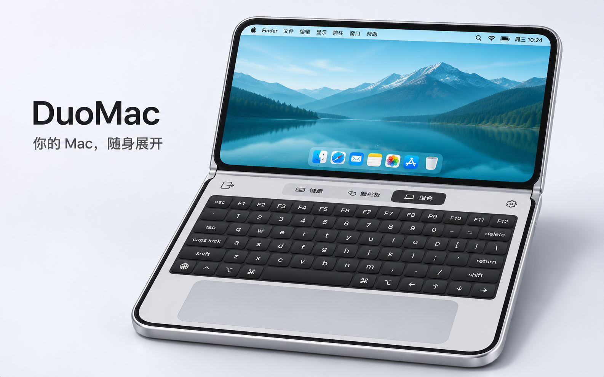
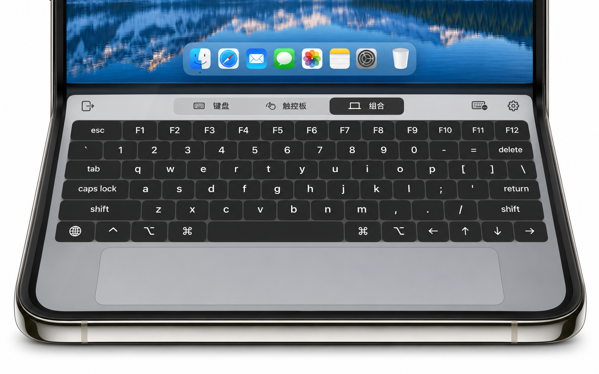
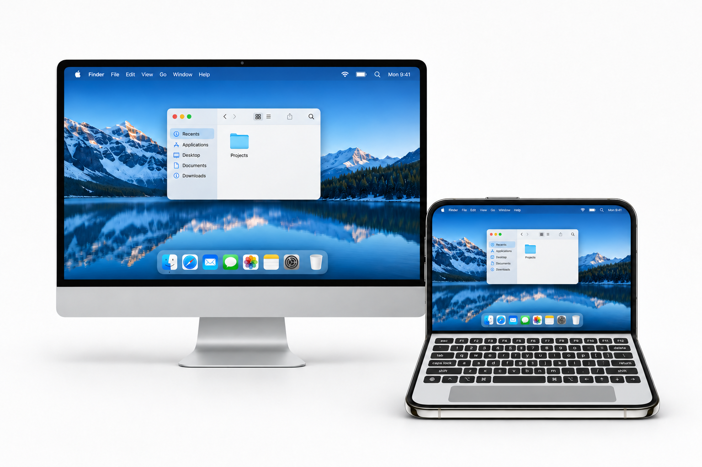

# DuoDesk · DUO你电脑

把 iPhone Duo 折成一台远程 Mac 笔记本。上半屏显示完整 Mac 桌面，下半屏提供键盘和触控板，支持纯键盘、纯触控板、键盘＋触控板三种模式。



| 键盘与触控板 | 连接你的 Mac |
| --- | --- |
|  |  |

*AI 生成的界面示意*

## 下载与安装

[Releases](https://github.com/xav1erwang/DuoDesk/releases) 中的安装包目前仍为草稿，尚未正式发布。现在可以先按下方步骤从源码构建和安装。

| 平台 | 下载文件 | 安装方式 |
| --- | --- | --- |
| macOS 27+ | `DUO-macOS-universal.dmg` 或 `.zip` | 将应用放入「应用程序」，首次启动按系统提示手动放行 |
| iOS / iPadOS 27.1+ | `DUO-iOS-unsigned.ipa` | 使用 Sideloadly 或 AltStore Classic，用自己的 Apple 账号重签安装 |

主要适配 iPhone Duo，两端需支持硬件 HEVC。Mac 包包含 Apple Silicon 与 Intel 版本。免费 Apple 账号通常每 7 天需要续签一次。

[详细安装步骤](docs/INSTALL.md) · [自动续签](Signing/README.md)

## 从源码构建

需要完整 Xcode 27.1 或更新版本。

```sh
git clone https://github.com/xav1erwang/DuoDesk.git
cd DuoDesk
bash Scripts/build-duodesk-mac.sh
```

Mac 应用生成在 `Build/DUO你电脑 Mac.app`，将它移入「应用程序」并打开。

在 Xcode 中打开 `iOSClient/Sill.xcodeproj`，选择 `Sill` Scheme，在「Signing & Capabilities」中选择自己的 Team 并设置唯一的 Bundle Identifier。用 USB 连接并信任 Duo，按提示开启开发者模式，选择该设备后运行，即可安装手机端。

## 运行与配对

1. 在 Mac 上打开「DUO你电脑 Mac」，按提示允许屏幕录制、辅助功能和本地网络访问，并保持应用运行。
2. 将 Duo 和 Mac 接入同一局域网，在 Duo 上打开「DUO你电脑」，允许本地网络访问，然后在列表中选择你的 Mac。
3. 首次配对时，在 Duo 上扫描 Mac 显示的二维码；也可以选择「输入配对码」，输入 Mac 上显示的数字并点击「配对」。扫码时按提示允许相机访问。
4. 配对成功后，选择要使用的显示器，例如「主显示器」。桌面显示在 Duo 上屏，下屏可切换键盘、触控板或组合模式。以后连接同一台 Mac 无需重复配对。
5. 使用完毕后，在 Duo 上点击「断开连接」。

如果列表中没有 Mac，检查两端是否在同一局域网、本地网络权限是否开启，以及 Mac 端是否正在运行。没有画面时检查 Mac 的屏幕录制权限；无法控制时检查辅助功能权限。

## 开源与贡献

DUO你电脑基于 [Sill](https://github.com/Saffsanity/sill) 开发，采用 [Apache-2.0 许可证](LICENSE)，上游归属与修改说明见 [NOTICE](NOTICE)。

[贡献说明](CONTRIBUTING.md) · [安全问题](SECURITY.md) · [隐私说明](docs/PRIVACY.md)
